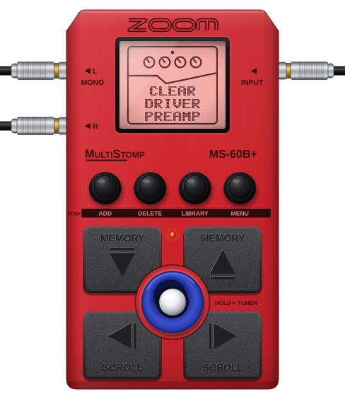
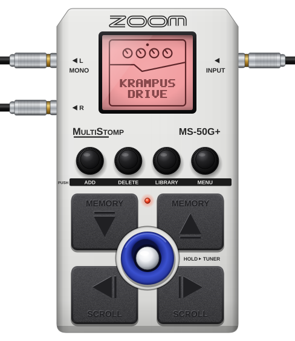
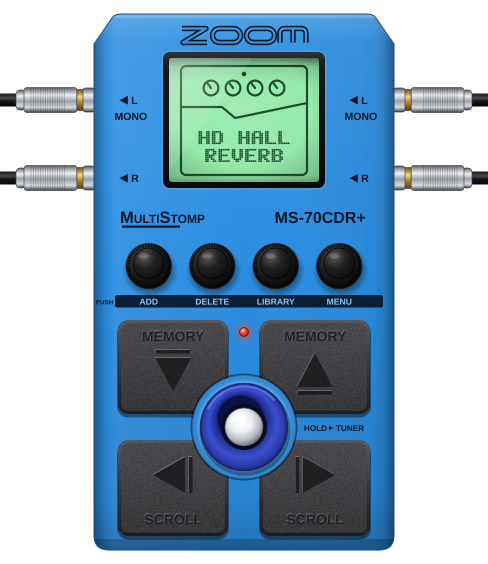
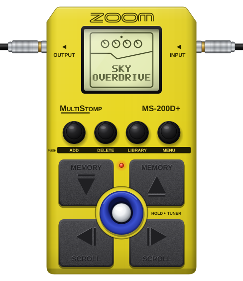
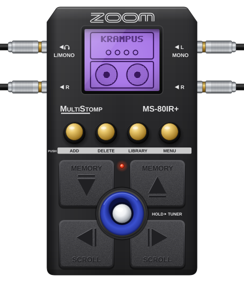
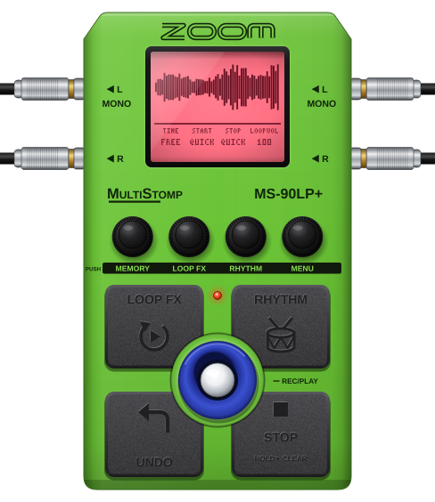
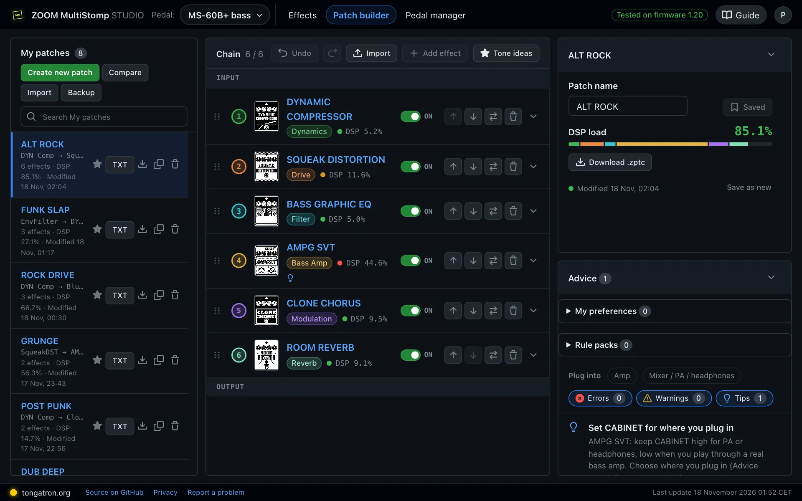
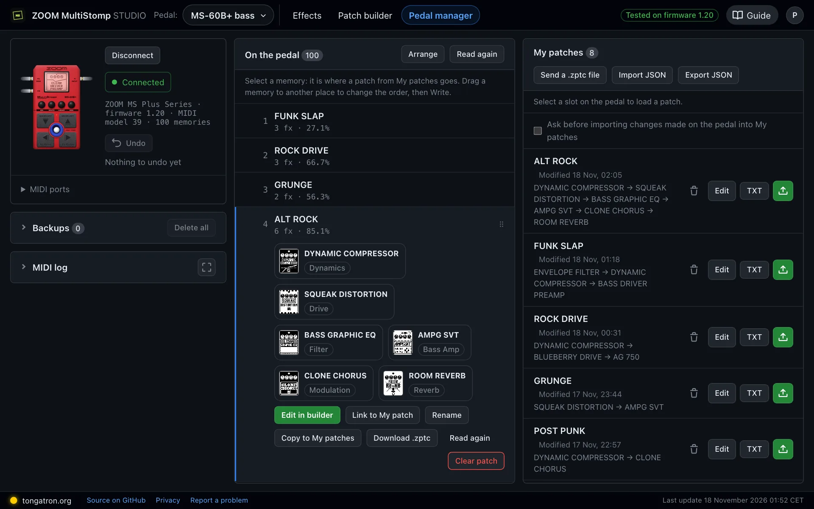

# 🎛️ ZOOM MultiStomp Studio

### Stop squinting at a tiny pedal screen. Design your tone on a big one.

**Six ZOOM MultiStomp pedals. 631 effects. One calm workspace.** 
Explore every effect · build patches with a live DSP meter and smart advice · export `.zptc` for Handy Guitar Lab · read and write the pedal over USB

 

&nbsp;
&nbsp;
&nbsp;
&nbsp;
&nbsp;

---

## 🎸 Pick your pedal

Switch pedal from the menu at the top of every page: each one has its own address (`/ms-60b/`, `/ms-50g/`, …), effects, advice and storage.

| Pedal | Effects | Build | On the pedal (USB) | More | Status |
|---|---|---|---|---|---|
| **MS-60B+** bass | [97 effects](https://zoommultistompstudio.tongatron.org/ms-60b/) | [Patch builder](https://zoommultistompstudio.tongatron.org/ms-60b/builder.html) | [Pedal manager](https://zoommultistompstudio.tongatron.org/ms-60b/pedal-manager.html) | [Tone ideas](https://zoommultistompstudio.tongatron.org/ms-60b/tones.html) · [Guide](https://zoommultistompstudio.tongatron.org/ms-60b/guide.html) · [Technical notes](https://zoommultistompstudio.tongatron.org/ms-60b/technical-notes.html) | ✅ Tested on firmware 1.20 |
| **MS-50G+** guitar | [127 effects](https://zoommultistompstudio.tongatron.org/ms-50g/) | [Patch builder](https://zoommultistompstudio.tongatron.org/ms-50g/builder.html) | [Pedal manager](https://zoommultistompstudio.tongatron.org/ms-50g/pedal-manager.html) | [Guide](https://zoommultistompstudio.tongatron.org/ms-50g/guide.html) · [Help us test](https://zoommultistompstudio.tongatron.org/ms-50g/help.html) | 🧪 Beta, not tested on a pedal yet |
| **MS-70CDR+** spatial | [149 effects](https://zoommultistompstudio.tongatron.org/ms-70cdr/) | [Patch builder](https://zoommultistompstudio.tongatron.org/ms-70cdr/builder.html) | [Pedal manager](https://zoommultistompstudio.tongatron.org/ms-70cdr/pedal-manager.html) | [Guide](https://zoommultistompstudio.tongatron.org/ms-70cdr/guide.html) · [Help us test](https://zoommultistompstudio.tongatron.org/ms-70cdr/help.html) | 🔬 Testing on a real pedal |
| **MS-200D+** drive | [217 effects](https://zoommultistompstudio.tongatron.org/ms-200d/) | — | [Pedal manager](https://zoommultistompstudio.tongatron.org/ms-200d/pedal-manager.html) (read-only) | [Guide](https://zoommultistompstudio.tongatron.org/ms-200d/guide.html) · [Help us test](https://zoommultistompstudio.tongatron.org/ms-200d/help.html) | 🧪 Beta |
| **MS-80IR+** amp and IR | [41 effects](https://zoommultistompstudio.tongatron.org/ms-80ir/) | — | [Pedal manager](https://zoommultistompstudio.tongatron.org/ms-80ir/pedal-manager.html) (read-only) | [Guide](https://zoommultistompstudio.tongatron.org/ms-80ir/guide.html) · [Help us test](https://zoommultistompstudio.tongatron.org/ms-80ir/help.html) | 🧪 Beta |
| **MS-90LP+** looper | [8 loop effects, 68 rhythms](https://zoommultistompstudio.tongatron.org/ms-90lp/) | [Loop tools](https://zoommultistompstudio.tongatron.org/ms-90lp/loop-tools.html) | — | [Guide](https://zoommultistompstudio.tongatron.org/ms-90lp/guide.html) · [Help us test](https://zoommultistompstudio.tongatron.org/ms-90lp/help.html) | 🧪 Beta |

Every pedal also has a **Resources** page (linked from its Guide) with the official ZOOM manuals and Effects List.

## 💡 Why

A ZOOM MultiStomp hides up to two hundred effects, a tight DSP budget and a 6-slot chain behind a screen the size of a postage stamp. Great sounds are in there. Getting to them is the hard part.

MultiStomp Studio puts the whole pedal on your desk:

- 🧠 **Know before you load.** The DSP meter and the advice engine tell you what will work, and *why*, before you touch the pedal.
- 🎯 **Find your tone faster.** Search, star your favorites, start from a ready chain, then tweak.
- 🔌 **Straight to the pedal.** Plug in a USB cable and write the patch from Chrome or Edge, with a backup first and a read-back check after.
- 🔒 **Yours to keep.** Free, open source, works offline, and your patches stay in your browser unless you choose to sync.
- 🔬 **Built on the real format.** The `.zptc` codec is proven byte for byte, so what you build is what the pedal gets.

## 📸 A look inside

<table>
<tr>
<td width="50%"></td>
<td width="50%"></td>
</tr>
<tr>
<td align="center"><b>Patch builder</b>: My patches, the chain with its DSP load, the patch and its advice</td>
<td align="center"><b>Pedal manager</b>: the pedal's memories next to your patches, over USB</td>
</tr>
</table>

## ✨ Features

| | |
|---|---|
| 🔎 **Effects library** | Every effect with the original ZOOM Effects List text, parameters and ranges, placement tips and an estimated DSP load. Search by name, model or parameter (press <kbd>/</kbd>); filter by category and feature (footswitch, tempo sync, stereo, dry mix) and, on the MS-200D+, by character. |
| ⭐ **Favorites** | Star the effects you love and filter the list down to them. |
| 🧱 **Patch builder** | Up to 6 effects, reorder by dragging or from the keyboard, every parameter with its real range. Undo and redo cover every edit, a deleted or duplicated patch too, and survive a reload of the tab. |
| 📊 **Live DSP meter** | The load of each effect and of the whole chain against the 100% limit, on the same scale as the Handy Guitar Lab "Processor" meter. |
| 🧠 **Advice engine** | Flags effect order, hot levels and heavy chains, explains *why* with sources and often offers a one-click fix. Its own rules for bass, guitar and spatial effects; on the bass it adapts to your rig (amp or mixer). Order rules are tips, never errors. |
| 🎚️ **Style profiles** *(bass)* | 12 playing styles, each with a starter chain and advice tuned to it. |
| 🧩 **Rule packs** | Write your own advice rules in a form and share them as `.json` (data only, every rule with a source). |
| 💾 **`.zptc` export / import** | Straight into Handy Guitar Lab: a reverse-engineered format, byte-for-byte exact on the MS-60B+. |
| 📚 **My patches** | A library per pedal: save, save as new, compare two versions, import, back up and restore. |
| 🎨 **Tone ideas** *(bass)* | Starting chains by style and by bassist, with a soft spot for alternative rock (grunge, post-punk, indie, fuzz). Every gear fact is sourced; one click opens the chain in the builder. |
| 🔌 **Pedal manager** | Over USB in Chrome or Edge (Web MIDI), no Handy Guitar Lab needed. Read every memory, open it in the builder, write a patch from My patches, rename, clear, move or swap memories, or drag the whole pedal into a new order. A backup comes before every write and a read-back check after it; **Undo** takes back any write. Backups can be restored; the MIDI log goes full screen. On the MS-60B+, MS-50G+ and MS-70CDR+; **read-only** on the MS-200D+ and MS-80IR+ (list the memories, keep raw backups, download `.zptc`). |
| 🔁 **Loop tools** *(MS-90LP+)* | Loop length from a tempo, the tempo for a length, tap tempo with a metronome, and a song planner, all within the pedal's limits (tempo 40–300, 90 minutes per loop). |
| 🧪 **Beta features** *(MS-60B+, MS-50G+, MS-70CDR+)* | Off by default, switched on from the account menu. **Live mode** sends parameter and ON/OFF changes to the pedal's edit buffer and exposes experimental effect selection, tempo, routing, R OUT, tuner and pedal-status controls; these are unverified on the beta pedals. **Pedal audition** plays a clean bass loop through the MS-60B+ while you edit. |
| 🔁 **Patch conversion research** *(MS-70CDR+)* | Includes an audited effect-ID map and an isolated experimental converter for original MS-70CDR patches. Compatible parameter names are translated when possible, with raw values as fallback; every converted patch must be verified on the pedal. |

The multi-pedal expansion is tracked with `npm run audit:expansion`: it currently inventories 24 missing MS-50G+ add-on IDs, the MS-80IR+ USER IR slot and the still-unmapped MS-200D+ catalog. It reports gaps only; identifiers will be added after a pedal export, backup or firmware artifact confirms them.

The experimental converter accepts either a decoded legacy patch JSON or the original binary payload: `npm run convert:legacy -- legacy.json converted.zptc` or `npm run convert:legacy -- patch.bin converted.zptc`. It also writes a verification report with conversion totals and unmatched-parameter details; an unmapped effect, partially translated effect or raw-parameter fallback makes the command exit with a warning status. Common parameter aliases and the original Ping-Pong Delay variant are handled explicitly, but remain experimental. The end-to-end binary path is covered by `npm run test:legacy-convert`.

Original MS patch payloads can be inspected with `npm run decode:legacy -- patch.bin`; the decoder shows known legacy effect names when available and preserves the raw effect blocks and metadata for verification before conversion.
| ☁️ **Free account** *(optional)* | Sync patches, settings, rule packs and pedal backups of the MS-60B+, MS-50G+ and MS-70CDR+ across devices. Download everything or delete the account at any time. Without an account everything stays in your browser. |
| 📰 **Change log and messages** | A public change log of what's new, and in-app messages from the administrators. |
| ✉️ **Contact us for bugs or anything** | A short form on every page; the message goes to the site's own Telegram bot and nothing is stored on the server. |
| 📖 **Guide and Resources** | A how-to Guide for every pedal, and the official ZOOM manuals (English and Italian) and Effects Lists one tab away. |
| 💻 **Offline** | Installable PWA for computers and tablets held sideways (windows of at least 800 × 640 px; there is no phone version). |

## 🆚 The six pedals

| Pedal | Effects | Amp models | Patch builder | Advice | Pedal manager | Account sync | Tested on the pedal |
|---|---|---|---|---|---|---|---|
| **MS-60B+** bass | 97 | 11 bass amps | ✅ all 97 | Order, levels, low end, output; 12 styles | ✅ read and write | ✅ | ✅ firmware 1.20 |
| **MS-50G+** guitar | 127 | 22 (PREAMP) | ✅ 103 (add-on IDs not known yet) | Order, one amp model, levels, delay, output (guitar sources) | ✅ read and write (beta) | ✅ | ❌ not yet |
| **MS-70CDR+** spatial | 149 | — | ✅ all 149 | Order of pitch, modulation, delay and reverb; levels, delay | ✅ read and write | ✅ | 🔬 in progress |
| **MS-200D+** drive | 217 | — | ⏳ needs the effect IDs | — | 👁️ read-only | — | ❌ not yet |
| **MS-80IR+** amp and IR | 41 | 23 | ⏳ not yet | — | 👁️ read-only | — | ❌ not yet |
| **MS-90LP+** looper | 8 loop effects, 68 rhythms | — | no chain (it's a looper): Loop tools | — | — | — | ❌ not yet |

Every pedal keeps its pages and data in its own folder: `site/ms-60b/`, `site/ms-50g/`, `site/ms-70cdr/`, `site/ms-200d/`, `site/ms-80ir/`, `site/ms-90lp/` (`pedal.js`, `effects-data.js`, `firmware-data.js`, `advice-rules.js`, effect images). The codec, builder, catalog, advice engine and Pedal manager are shared scripts in `site/`, and the list of pedals lives in one file, [`site/pedals.js`](site/pedals.js).

The paused development roadmap is in [`TODO.md`](TODO.md), including the evidence still needed before enabling broader pedal support.

## 🙋 Help wanted

Only the MS-60B+ has been fully tested on a real pedal. The other pages are built from the official ZOOM documentation, and a little of an owner's time would show what works and what needs fixing. Nobody is expected to do everything: each page lists the checks that would help, with the time each takes, and how to get in touch.

- 🎸 [Help us test the MS-50G+](https://zoommultistompstudio.tongatron.org/ms-50g/help.html): short tests with the pedal and Handy Guitar Lab on an iPhone or iPad.
- 🌊 [Help us test the MS-70CDR+](https://zoommultistompstudio.tongatron.org/ms-70cdr/help.html): the Pedal manager on a free test memory, generated patches, six-effect chains and the processor percentage.
- 🔥 [Help us test the MS-200D+](https://zoommultistompstudio.tongatron.org/ms-200d/help.html): a backup of every memory with the read-only Pedal manager, to find its effect IDs and how its patches are stored.
- 🔊 [Help us test the MS-80IR+](https://zoommultistompstudio.tongatron.org/ms-80ir/help.html): the ID of the USER IR effect and how the three slots of a patch are stored.
- 🔁 [Help us test the MS-90LP+](https://zoommultistompstudio.tongatron.org/ms-90lp/help.html): whether the pages are right, and what the pedal shows when it is connected to a computer.

## 🔬 Under the hood: cracking `.zptc`

ZOOM documents the effects, not the patch file, so the format was **rebuilt from scratch**: no firmware or app disassembly, just seven patches that each differ by one change, a hex editor and a lot of patient diffing. It turned out to be bit-packed: each effect is a 24-byte block read as one 192-bit integer (ON/OFF, effect ID, then the parameters), inside a `PTCF` header with tagged blocks.

The codec is proven four ways on the MS-60B+: byte-for-byte round-trips, files rebuilt from readable values, generated patches checked on a real pedal (firmware 1.20), and the browser builder producing the same bytes. The other pedals reuse it with their own effect tables; effect IDs, DSP figures and the USB SysEx protocol come from the open-source [zoom-zt2](https://github.com/mungewell/zoom-zt2) project (MIT). For MS Plus commands and patch transport, we also treat [thammer/zoom-explorer](https://github.com/thammer/zoom-explorer) as a trusted, tested reference: its documented messages and observations are accepted as working evidence, especially for the MS-50G+ path. It does not by itself confirm every effect ID or every pedal model; the repository explicitly leaves other-pedal device IDs as an investigation item. Some details were only found on the pedal: a patch goes to it without its BLANK slot, because the pedal accepts a 7-entry patch, reads it back unchanged, and then drops its last effect.

The effect text of every pedal is extracted from the official Effects List PDFs and checked word for word against them. The pedal drawings on the home page and in the Pedal managers are SVG generated from one measured model ([`site/pedal-model.js`](site/pedal-model.js)).

Official firmware is audited without checking proprietary binaries into the repository: `npm run test:firmware` validates the local effect catalogs, and `node tools/firmware-audit.mjs <pedal> <updater-or-extracted-directory>` inspects supplied updater contents for embedded `ZDLF`/`.ZD2` effects, IDs, versions, targets and DSP values. See [`firmware/README.md`](firmware/README.md).

📄 Read the full story: [Technical notes](https://zoommultistompstudio.tongatron.org/ms-60b/technical-notes.html) · [`docs/zptc-reverse-engineering.md`](docs/zptc-reverse-engineering.md)

## 🛠️ Run it yourself

Clone it, start one Node command, and the whole studio is on `localhost`. No build step, no bundler, no dependencies to install for the site itself (Playwright is only for the browser tests).

👉 **[How to install](INSTALL.md)**: run it locally, repository layout, and the test suite.

👉 **[Deploy notes](docs/DEPLOY.md)**: test, commit and publish.

## 🔐 Privacy

No tracking cookies, no newsletter. Without an account your data never leaves the browser; with one, it lives on a server run by tongatron.org, backed up daily and kept 30 days. Messages sent with Contact us for bugs or anything go to Telegram and are not stored on the server. The details: [`site/privacy.html`](site/privacy.html).

## 📌 Good to know

- 🇬🇧 The site is English-only.
- 📜 Effect and parameter descriptions are copied **verbatim** from the official ZOOM Effects Lists.
- 🎚️ MS-60B+ tested on firmware 1.20 · MS-70CDR+ tests under way · MS-50G+, MS-200D+, MS-80IR+ and MS-90LP+ not tested yet.
- 🔌 The Pedal manager needs Chrome or Edge on a computer (Web MIDI). The USB protocol is not documented by ZOOM: on pedals still in testing, write to a free memory and check the patch on the pedal.
- 🧭 Effect order is convention: order advice is a tip or a warning, never an error.

## ⚖️ Credits and legal

Effects data and manual text © ZOOM CORPORATION. Manufacturer names are used only to describe sonic character. This is an independent fan project, not affiliated with or endorsed by ZOOM. Effect tables and the USB protocol thanks to [zoom-zt2](https://github.com/mungewell/zoom-zt2).

Special thanks to Keiichiro Araihara for his help with the Zoom MS-70CDR+ pedal.

---

Made with 🎶 and a hex editor by [**tongatron.org**](https://tongatron.org)

